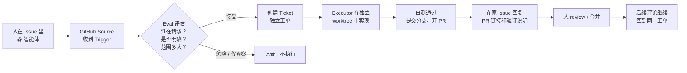

# agent-sandbox

> **一个公开的 super-agent 联调仓库。** 这里没有业务代码，只有一次真实的仓库接入：用 GitHub Issue 发起请求，观察一个主动式编码智能体如何接单、在独立目录里工作，并把结果以 Pull Request 的形式交还给人审查。
>
> **English:** A public sandbox for testing dsh-superagent against a real GitHub repository. It is a sample used for testing and is **not intended for production use**.

如果你想先看一个更直观的版本，可以直接打开 [index.html](index.html)；它用图表和真实事件把下面这些内容重新讲了一遍。

---

## 这个仓库是什么

`agent-sandbox` 不是一个库，也没有线上服务。它是一个**刻意保持简单的试验场**：

- 起点只有一份 README，方便看清智能体到底改了什么；
- 接入了一个正在运行的 super-agent 部署，监听这个仓库的 GitHub 事件；
- 每个请求都会变成一个独立的工单（Ticket），在独立的 git worktree 中执行；
- 每一次接受、执行、提问和交付，都会留在 Issue、PR 或面板里，可以逐条核对；
- 目前只用于测试和演示，不承载真实业务，也不要把密钥或私有数据放进来。

一句话：**它是一间“透明的厨房”**。顾客在 Issue 里点菜，智能体在后厨做菜，最后把成品（PR）端出来，所有人能看到它用了哪些食材、走了哪条流水线。

## super-agent 是什么

dsh-superagent 是 DeepSeek Harness 的一个研究型插件：**把编码智能体接到一个 GitHub 仓库上，让它像同事一样接收请求、推进工作、交付代码。**

它和“在聊天框里回答问题”的助手不同。它的目标不是生成一段看起来正确的文字，而是把一个请求推进到**可审查、可合并的代码变更**，然后停下来等人决定。

它把工作拆成几个清楚的角色：

| 角色 | 做什么 | 在本仓库中的表现 |
| --- | --- | --- |
| Source（来源） | 监听 GitHub 事件：发给智能体的通知、已订阅 Issue/PR 的讨论、PR 合并或关闭、CI 变化 | GitHub 已连接，每 60 秒轮询一次 |
| Trigger（触发） | 一条不可变的事件，例如“某人在 Issue 里 @ 了智能体” | Issue #1、#3 各产生一条 |
| Eval（评估） | 判断这条事件是否在请求工作、发起人是否被允许、请求范围有多大 | 当前策略版本 `6ae5361…` |
| Ticket（工单） | 一次被授权的工作，记录范围、来源、订阅关系和执行历史 | Issue #3 对应的工单 |
| Executor（执行者） | 在独立目录里读代码、改代码、跑检查、开 PR | 一个 worker Session，最多同时 3 个 |
| Channel（回信通道） | 把确认、结果或问题写回原来的对话 | Issue 评论、PR 评论和审查线程 |

### 它坚持的一条原则

> **占用尽可能少的人类注意力，交付尽可能多的价值。**

具体到行为上：

- 只接受**明确 @ 它**的请求，或者团队书面规则允许的请求；
- 收到请求后**只确认一次**，不刷进度；
- 工作期间保持安静；
- 只有在“结果可以看了”“需要人做决定”“做不下去”三种情况下才再次开口；
- 每次在 GitHub 上说话，开头都会注明 **“This is by an automated agent, not a human.”**，避免被误认为真人。

### 它不是什么

- **不是自动合并机器人。** 本部署没有配置自动合并，PR 需要人来审查和合并。
- **不是万能聊天助手。** 它只处理与这个仓库有关、且被授权的开发者请求。
- **不是没有边界的后台程序。** 它有人力配置的允许列表、评估模式、并发上限和目录隔离。
- **不是生产级成品。** 它是一个研究原型，适合观察和试验，不适合直接当成关键基础设施。

## 它到底有什么用

把“智能体接仓库”翻译成日常研发场景，它主要解决四类问题：

| 场景 | 人的动作 | 智能体的动作 | 最终产出 |
| --- | --- | --- | --- |
| 小而明确的改动 | 在 Issue 里描述要改什么 | 找到文件、实现、自测、提交 | 一个可 review 的 PR |
| 讨论落成代码 | 在 Issue/PR 里继续讨论 | 把后续要求当作同一工单的输入，保持上下文 | 增量提交，而不是从零重来 |
| 重复性维护 | 提一个模板化请求 | 按同样流程执行，留下同样的记录 | 稳定、可审计的变更 |
| 观察智能体是否靠谱 | 看 Issue、PR 和面板 | 接单、执行、报告或求助 | 一套可核对的证据链 |

它真正的价值不在“写代码有多快”，而在**把不确定的智能体行为装进一个可审查的流程**：

1. **权限可收口。** 只有允许列表里的账号能发起工作；不在列表里的请求会被过滤或忽略。
2. **执行可隔离。** 每个工单有自己的目录和分支，不会直接改主分支。
3. **结果可审查。** 所有交付都经过 PR，人可以看 diff、跑测试、要求修改或拒绝。
4. **过程可追溯。** 从 Issue 到 Trigger、Eval、Ticket、Assignment、PR，每一步都有记录。
5. **打扰可控制。** 它不会为了“显得努力”而不断汇报，只在人需要出现时出现。

## 一次请求的完整旅程



用文字说就是：

1. **点名。** 允许列表里的同事在 Issue 里 @ 智能体，并说清楚要什么。
2. **接单。** GitHub Source 把它变成一条 Trigger；Eval 检查发起人、请求强度和范围。
3. **建工单。** 接受后创建 Ticket，并把原 Issue 订阅为这个工单的对话线程。
4. **开工。** Executor 在专属目录里读仓库、改代码、跑检查；需要方向性决策时会停下来问人。
5. **交付。** 提交到 `agent/<工单短名>` 分支，开 PR，并回到原 Issue 报告“可以看了”。
6. **收尾。** 人审查、合并；PR 或 Issue 上的后续讨论会继续送到这个工单，不需要重新 @。

### 关于“评估模式”

当前部署的 Eval 模式是 **`observe`（观察）**：

- 对**明确 @ 智能体**的请求，正常受理；
- 对“推测出来可能要做”的候选（例如没有 @ 的新 Issue、机器人评论），只记录“如果允许会怎么做”，**不会真的执行**。

这相当于让智能体先“见习”：规则没把握时，先看它会怎么判断，再决定要不要放开为 `auto`。这是一种故意的保守。

## 本仓库接入后的状态

以下快照来自 2026-11-05 的运行面板和 GitHub，方便读者对照；数字会随着后续请求变化。

| 项目 | 当前值 | 说明 |
| --- | --- | --- |
| 仓库 | [`wzwangzhen321/agent-sandbox`](https://github.com/wzwangzhen321/agent-sandbox) | 公开示例仓库，默认分支 `main` |
| 智能体账号 | `@wzwangzhen321` | 以这个账号评论、推分支、开 PR |
| Source | GitHub，已启用 | 每 60 秒轮询；接收发给智能体的通知、已订阅 Issue/PR 的讨论、PR 合并/关闭 |
| 全量接收 | 关闭 | 没有 @ 的新 Issue、新 PR、普通评论和默认分支 CI 不会主动进入评估 |
| 允许发起工作的账号 | `@hualidezhen` | 只有列表内的账号可以发起明确请求 |
| Eval 模式 | `observe` | 推测型候选只记录；明确请求正常受理 |
| 执行并发 | 3 个 worker | 一个工单占用一个执行槽 |
| 自动合并 | 未启用 | PR 由人审查、由人合并 |
| Feishu | 未配置 | 当前只有 GitHub 入口 |
| 运行面板 | DeepSeek Harness Web 的 **Superagent** 页 | 可看工单、触发、评估、执行和设置 |
| 当前健康状态 | `ready` | 启动、投递、评估、回复等通道均正常 |

### 已经真实发生的事

| 时间（UTC+8） | 发生了什么 | 结果 |
| --- | --- | --- |
| 11-05 09:08 | `@hualidezhen` 打开 Issue [#1 测试自动拾取](https://github.com/wzwangzhen321/agent-sandbox/issues/1) | 智能体在半分钟内回复“收到”，说明会新增 Usage 一节 |
| 11-05 09:14 | 智能体提交分支并打开 PR [#2](https://github.com/wzwangzhen321/agent-sandbox/pull/2) | README 新增 Usage，改动 1 个文件、+5/−1 行 |
| 11-05 09:16 | 智能体在原 Issue 回复“PR 已就绪，等待人工合并” | 因为本部署没有合并 CLI，明确说明需要人合并 |
| 11-05 09:23 | `@hualidezhen` 合并 PR #2 | 第一次完整往返闭环 |
| 11-05 10:04 | `@hualidezhen` 打开 Issue [#3 补充一个 html 的介绍页面](https://github.com/wzwangzhen321/agent-sandbox/issues/3) | 就是你现在读到的这份说明和 `index.html` |
| 11-05 10:06 | 面板中出现对应工单，Executor 开始工作 | 在独立 worktree 中完成文档和页面 |

这组时间线说明了三件事：

- **它不是“秒回一段话”**，而是真的走了“接单—执行—交付—人工合并”的流程；
- **它没有自己合并**，合并动作由人完成；
- **它的工作可以被核对**，Issue、PR、面板记录互相对应。

## 这个仓库和 super-agent 到底有什么用

可以分三个视角看：

### 对 super-agent 的维护者

这是一个**低风险的公开金丝雀**：用真实 GitHub 事件验证 Source、Trigger、Eval、Ticket、Executor、Outbox 和面板是否协同工作；出错时可以放心重试，不涉及生产数据。

### 对想接入自己仓库的团队

这是一份**可对照的样例**：接入后大概会看到什么状态、Issue 会怎么被回复、PR 长什么样、哪些动作需要人。可以先在这个仓库里体会流程，再决定是否接到自己的仓库。

### 对第一次听说 super-agent 的读者

这是一篇**带证据的说明**：不是产品宣传页，而是把一次真实接入的过程、边界和结果摊开给人看。你可以从 Issue #1 一路点到 PR #2，检查每一步是否属实。

## “连接一个仓库”具体意味着什么

把 super-agent 接到一个仓库，通常需要下面几件事同时成立：

1. **一个智能体 GitHub 账号。** 它需要有仓库写权限；所有评论、分支和 PR 都以这个账号的身份出现。
2. **一个独立运行的 DSH profile。** super-agent 作为 DeepSeek Harness 的插件运行，和日常开发用的 Session 分开，避免互相影响。
3. **一份本地 clone 和 worktree 准备命令。** 每个工单从仓库拉一个独立工作目录，互不覆盖。
4. **一份策略。** 谁可以发起工作、哪些推测型请求只观察、最多同时跑几个 worker、哪些命令禁止执行。
5. **一条人工审查通道。** 智能体负责把结果做到“可审查”，人负责决定是否合并。

这里最重要的一条是：**智能体的写权限是真实的。** 它能推分支、开 PR、评论；它不是沙盒里的玩具。因此接入时应遵循“先窄后宽”：

- 先只允许一两个账号；
- 先使用 `observe` 模式；
- 先不给自动合并；
- 先在公开、无敏感数据的仓库里试；
- 确认行为符合预期后，再逐步扩大范围。

## 为什么它看起来“很安静”

第一次接触的人常问：它接单后怎么没动静了？

这是设计目标，不是故障。它的沟通规则是：

- **收到时确认一次**：说明它理解的任务；
- **执行中不刷屏**：进度留在 PR 和面板里；
- **就绪时报告一次**：给出 PR 链接和验证结果；
- **需要人时提问一次**：把问题说清楚，而不是让人猜；
- **做不下去时说明原因**：给出现状、卡点和下一步。

所以，安静通常意味着**它正在工作**。如果它停在“等待回答”或“阻塞”，面板会明确标出来，而不是靠刷消息提醒你。

## 如何在这个仓库里发起一次请求

1. 新建一个 Issue，或在已有 Issue/PR 里继续讨论。
2. 用**允许列表里的账号** @ `@wzwangzhen321`，并写清楚要改什么、验收标准是什么。
3. 等它回复“收到”。之后可以去做别的事，不需要盯着。
4. 收到 PR 后，看 diff、跑你关心的检查，决定合并、要求修改或关闭。
5. 后续意见直接留在原 Issue 或 PR 里即可，它会回到同一个工单继续处理。

一个具体例子：

```text
@wzwangzhen321 请在 README 的“目录”一节里补上 index.html 的说明，
并确认链接在 GitHub 上可以打开。
```

不太有效的例子：

```text
@wzwangzhen321 帮我优化一下这个项目。
```

后者没有目标、范围和验收标准，智能体只能停下来问人，反而消耗更多注意力。

## 目录

| 文件 | 内容 |
| --- | --- |
| `README.md` | 你正在读的说明：super-agent 是什么、这个仓库接入了什么、当前状态和用法 |
| `index.html` | 一页式图文介绍，适合直接给非技术同事看 |

本地预览 `index.html`：

```sh
python3 -m http.server 8000
# 然后打开 http://127.0.0.1:8000/
```

页面是单文件、无外部依赖、响应式布局，支持浅色和深色系统主题。

## 边界与注意事项

- **研究原型，不是生产软件。** 行为和接口都可能变化，请先在你的环境里验证。
- **智能体拥有真实写权限。** 它在操作者的 OS 用户下运行，工具层面有策略约束，但不是强安全沙盒；需要强隔离时，应使用专门的 OS 账号。
- **没有自动合并。** 本部署的 PR 必须由人合并；这是故意保留的人类闸门。
- **公开仓库。** 请不要在 Issue、评论或 PR 里放密钥、客户数据或私有链接。
- **状态会变化。** 本文中的数字和事件是 2026-11-05 的快照，后续请求会改变它们；流程和边界才是稳定的部分。

## 相关链接

- [本仓库](https://github.com/wzwangzhen321/agent-sandbox)
- [Issue #1：测试自动拾取](https://github.com/wzwangzhen321/agent-sandbox/issues/1)
- [PR #2：Add Usage section to README](https://github.com/wzwangzhen321/agent-sandbox/pull/2)
- [Issue #3：补充一个 html 的介绍页面](https://github.com/wzwangzhen321/agent-sandbox/issues/3)
- [DeepSeek Harness](https://www.deepseek.com/en/harness/)

---

<sub>本仓库中的自动化消息和 PR 均以智能体账号身份提交，并在 GitHub 消息开头注明 “This is by an automated agent, not a human.”。文档中的接入状态来自运行面板与 GitHub 的公开记录。</sub>
